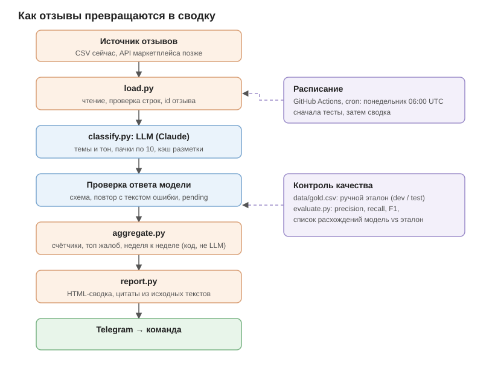

# Luxhommè: что говорят покупатели, за пять минут в неделю

Скрипт берёт свежие отзывы, раскладывает их по темам и тону с помощью LLM и присылает команде сводку в Telegram: сколько отзывов по каждой теме, на что жалуются чаще всего (с цитатами) и что изменилось к прошлой неделе.



## Быстрый старт

Нужен только Python 3.10+. Внешних зависимостей нет.

**1. Без ключей** (разметка по ключевым словам, сводка печатается в консоль):

```bash
python -m src --provider keywords
```

**2. С LLM.** Скопируйте `.env.example` в `.env`, впишите `ANTHROPIC_API_KEY`:

```bash
python -m src --provider llm
```

**2б. Без оплаты Anthropic.** Подойдёт любой OpenAI-совместимый API, например OpenRouter с бесплатной моделью. Впишите `LLM_API_KEY` (при необходимости `LLM_BASE_URL` и `REVIEW_LLM_MODEL`) и запускайте с `--provider openai`:

```bash
python -m src --provider openai
```

**2в. Локальная модель (Ollama), без ключей и лимитов.** Установите Ollama, выполните `ollama pull qwen2.5:7b` и впишите в `.env`:

```
LLM_API_KEY=ollama
LLM_BASE_URL=http://localhost:11434/v1
REVIEW_LLM_MODEL=qwen2.5:7b
LLM_TIMEOUT=300
```

Запуск тот же: `python -m src --provider openai`.

**3. С отправкой в Telegram.** Создайте бота через @BotFather, впишите `TELEGRAM_BOT_TOKEN` и `TELEGRAM_CHAT_ID` в `.env`:

```bash
python -m src --provider llm --send
```

Остальные команды:

```bash
python -m src.evaluate --provider llm --split test   # точность разметки по эталону
python -m unittest discover -s tests -t .            # тесты
```

Свои отзывы: CSV с колонками `DATE,SKU,RATING,TEXT` (дата `ДД.ММ.ГГГГ`), путь через `--csv`. Неделя считается как 7 дней, заканчивающихся в последний день данных (или в `--end`).

## Как это устроено

| Шаг | Файл | Что делает |
|---|---|---|
| Загрузка | `src/load.py` | читает CSV, битые строки пропускает с причиной, считает id отзыва |
| Разметка | `src/classify.py`, `prompts/classify.md` | LLM ставит темы и тон пачками по 10, ответы кэшируются |
| Проверка ответа | `src/classify.py` | схема ответа; при ошибке повтор только по проблемным отзывам, модели передаётся текст ошибки |
| Подсчёт | `src/aggregate.py` | счётчики, топ жалоб, сравнение недель |
| Сводка | `src/report.py` | HTML для Telegram, делится на сообщения по лимиту |
| Отправка | `src/telegram.py` | повторы при 429 и 5xx, токен в ошибки не попадает |
| Расписание | `.github/workflows/weekly-digest.yml` | по понедельникам запускает тесты, затем сводку |

Принципы, которые я закладывал:

- **Модель только размечает. Числа и цитаты считает код.** Цитата в сводке это дословный текст отзыва, который выбирает код, а не модель. Так модель не может выдумать цифру или цитату.
- **Темы заданы списком в `src/config.py`.** Промпт, оценка и сводка берут их оттуда, поэтому недели сравнимы.
- **Тихой подмены нет.** Если LLM недоступна, скрипт сообщает об этом. На ключевые слова он сам не переключается. Отзывы, которые модель не смогла разметить, попадают в сводку как «не разобрано».
- **Тренд только от 3 жалоб** (`MIN_SIGNAL`). «1 → 2» не называем ростом.
- **Флаг «оценка и текст расходятся»** показывает отзывы, где звёзды и смысл не совпадают. Часто это саркастичные отзывы.

## Проверка точности

Эталон `data/gold.csv` (45 отзывов) разделён на **dev** (30) и **test** (15). Промпт правят по dev, а test не трогают до финальной проверки, чтобы цифры не были подогнаны.

```bash
python -m src.evaluate --provider keywords --split all
python -m src.evaluate --provider llm --split dev
python -m src.evaluate --provider llm --split test
```

Результаты сохраняются в `results/`.

> **TODO (заполнить своими цифрами после прогона с LLM):**
>
> | Вариант | dev F1 | test F1 | Тон среди угаданных тем |
> |---|---|---|---|
> | Ключевые слова | | | |
> | LLM, промпт v1 | | | |
> | LLM, после правок | | | |

## Разбор

> **TODO: перепишите этот раздел своими словами после того, как запустите решение и посмотрите на ошибки модели.** Ниже подсказки, о чём писать. Ответы должны быть вашими, а не из этого черновика.

**Как проверял, что AI не ошибается в темах.** (Что именно сравнивал, на скольких отзывах, какие ошибки нашёл, что поменял в промпте и что это дало.)

**Что сделал бы иначе в продакшене.** (Например: реальный API маркетплейса вместо CSV, постоянное хранилище разметки между запусками, повторная разметка при смене промпта, алерты на резкий рост жалоб, учёт стоимости запросов.)

**Вопросы маркетингу до старта.** (Например: какие маркетплейсы и какой объём отзывов в неделю? Кто читает сводку и как часто? Какие темы реально важны, чтобы согласовать список? Что считать срочным сигналом, например перегрев или безопасность? Что делать с отзывами без текста и с рекламой? Нужно ли связывать с возвратами и продажами?)

## Честные ограничения

- Отзывы в `data/reviews.csv` синтетические. Их написал ИИ по образцу из задания, затем я оставил в них неоднозначные случаи (сарказм, несколько тем, «ок»).
- Эталон `data/gold.csv` сначала составил ИИ, поэтому его нужно проверить глазами и исправить спорные метки.
- Базовые правила в `src/keywords.py` писались с оглядкой на эти же 45 отзывов, поэтому их точность оптимистична. Это ориентир, а не честная оценка.
- В GitHub Actions кэш разметки не сохраняется между запусками, так что каждая неделя размечается заново. Для данных этого размера это дёшево.
- Реальный API маркетплейса не подключён, источник пока CSV.
- Запуск с настоящей LLM и отправка в Telegram в этом репозитории не проверялись без ключей. Проверьте их у себя.
